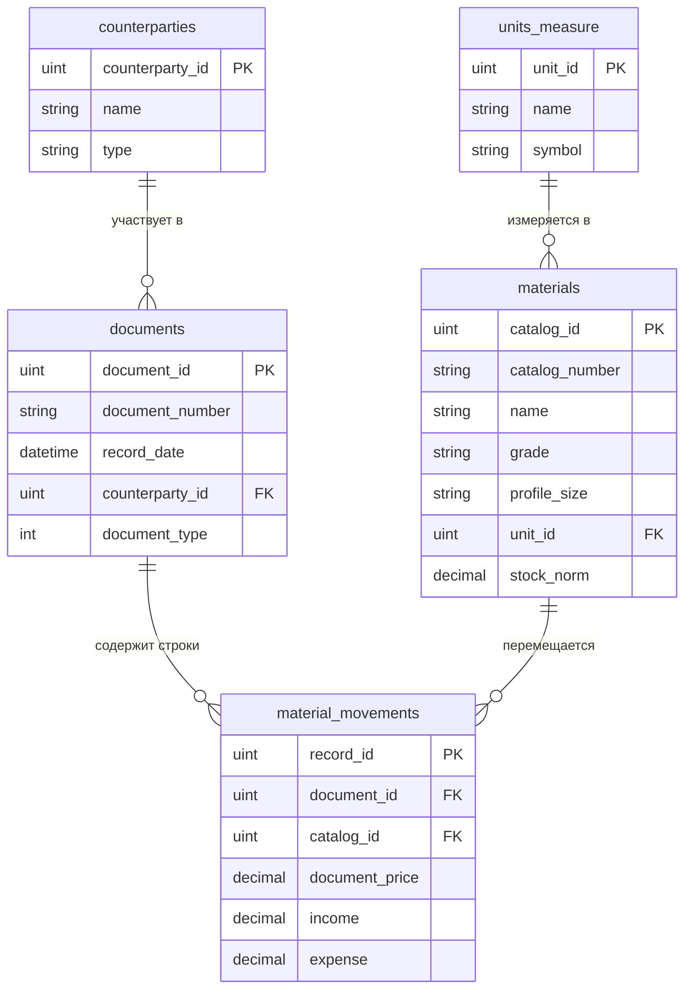

# MyAPI — Система складского учета материалов и документооборота

REST API сервис на платформе **.NET 10 (C#)** для учета материальных ресурсов, движения номенклатуры на складе, регистрации первичных документов и взаимодействия с контрагентами с поддержкой нескольких СУБД (**MariaDB** и **SQLite**).

---

## Содержание
1. [Инициализация базы данных в MariaDB](#1-инициализация-базы-данных-в-mariadb)
   - [SQL-скрипт инициализации](#11-sql-скрипт-инициализации-init_mariadbsql)
   - [Программная инициализация на C# (Driver)](#12-программная-инициализация-на-c-драйвер-mariadb)
2. [Описание проекта](#2-описание-проекта)
   - [2.1. Чем обусловлена данная архитектура](#21-чем-обусловлена-данная-архитектура)
   - [2.2. Почему мы используем MariaDB и SQL](#22-почему-мы-используем-mariadb-и-sql)
   - [2.3. Полное описание проекта и структуры](#23-полное-описание-проекта-и-структуры)
3. [Схема данных и сущности](#3-схема-данных-и-сущности)
4. [Инструкция по установке и запуску](#4-инструкция-по-установке-и-запуску)

---

## 1. Инициализация базы данных в MariaDB

Инициализация таблиц для MariaDB реализована в проекте двумя способами:
1. **Автономный SQL-скрипт** [`init_mariadb.sql`](./init_mariadb.sql) — для развертывания через CLI MariaDB/MySQL, phpMyAdmin, HeidiSQL, DBeaver или Docker.
2. **Программная инициализация на C#** в проекте [`MyAPP.Drivers.MariaDB`](./MyAPIMy/Drivers/MariaDB/) — по аналогии со SQLite через класс `DatabaseInitializer` и цепочку инициализаторов таблиц `ITableInitializer`.


### 1.2. Программная инициализация на C# (Драйвер MariaDB)

В проекте `Drivers/MariaDB` с использованием высокопроизводительного ADO.NET провайдера `MySqlConnector` созданы:
- `ITableInitializer`: интерфейс для табличных инициализаторов с указанием приоритета (`Order`).
- Классы таблиц: `UnitsMeasureTable`, `CounterpartiesTable`, `MaterialsTable`, `DocumentsTable`, `MaterialMovementsTable`.
- `DatabaseInitializer`: открывает соединение, стартует транзакцию и выполняет создание таблиц в строгом порядке, учитывая внешние ключи.
- Метод `Database.Initialize()`: вызывается при старте приложения для автоинициализации схемы в MariaDB.

---

## 2. Описание проекта

### 2.1. Чем обусловлена данная архитектура

Архитектура проекта построена на принципах **многоуровневой модульной архитектуры (Layered / Hexagonal Architecture)** с четким разделением ответственности (Separation of Concerns):

1. **Изоляция предметной области (`Common`) от деталей инфраструктуры**:
   - Ядро приложения (`Domain Entities` и интерфейсы репозиториев `IDBUnits`) находится в сборке `Common` и не зависит ни от ASP.NET Core, ни от конкретной базы данных.
   - Это гарантирует, что бизнес-правила и модели данных остаются чистыми и переносимыми.

2. **Принцип инверсии зависимостей (Dependency Inversion Principle — DIP)**:
   - Высокоуровневые модули (`API`) не зависят от низкоуровневых драйверов СУБД. Оба слоя зависят от интерфейсных абстракций (`IDatabase`, `IUnitsMeasure`, `IMaterials` и т.д.).
   - Это позволяет подменять слой хранения данных без изменения бизнес-логики контроллеров и конечных точек.

3. **Паттерн "Драйвер" (Driver / Provider Pattern)**:
   - Доступ к базам данных вынесен в отдельные проекты-драйверы: `Drivers/SQLite` и `Drivers/MariaDB`.
   - **Зачем это нужно**:
     - **SQLite** используется для локальной разработки, быстрого прототипирования и автономных тестов без необходимости поднимать сервер СУБД.
     - **MariaDB** используется для сетевой работы, многопользовательского режима, промышленного развертывания и высоких нагрузок.
     - Переключение между СУБД происходит конфигурационно в `appsettings.json` и при регистрации в DI-контейнере.

4. **Богатая модель данных с самовалидацией (Rich Domain Model)**:
   - Сущности предметной области инкапсулируют логику валидации своих полей через регулярные выражения (`Regex`). Например, проверка формата номенклатурного номера, допустимой длины наименований, неотрицательности цен и количеств.
   - Это исключает появление некорректного состояния объекта еще до обращения к базе данных.

5. **Модульная инициализация схемы (Table Initializers)**:
   - Каждая таблица описывается отдельным классом, реализующим `ITableInitializer` со свойством `Order`.
   - Это предотвращает ошибки зависимостей внешних ключей (FK) при создании таблиц и обеспечивает атомарность создания в единой транзакции.

---

### 2.2. Почему мы используем MariaDB и SQL

1. **Реляционная структура данных**:
   - Складской учет и документооборот имеют строго реляционную природу. Сущности связаны жесткими отношениями:
     - Движение материала ссылается на документ и номенклатуру.
     - Номенклатура ссылается на единицу измерения.
     - Документ привязан к контрагенту.
   - Реляционные СУБД на уровне движка обеспечивают **ссылочную целостность** (`FOREIGN KEY`, каскадное удаление или запрет удаления связанных записей `RESTRICT`).

2. **Транзакционность и гарантии ACID**:
   - В складских операциях критически недопустимы рассинхронизация или частичное проведение проводок. Если накладная проводится, то должны одновременно обновиться движения материалов, списаться остатки и зафиксироваться документ.
   - MariaDB с движком **InnoDB** предоставляет полноценную поддержку транзакций (`ACID`), блокировки на уровне строк (`Row-level locking`) и изолированность транзакций.

3. **Эффективность вычислений на стороне СУБД с помощью SQL**:
   - Расчет текущего складского остатка:
     $$\text{Остаток} = \sum(\text{Income}) - \sum(\text{Expense})$$
     В SQL такой расчет выполняется одной агрегатной операцией `SUM()` с группировкой по индексу, не требуя выгрузки миллионов строк в оперативную память C#-приложения.
   - Фильтрация по диапазону дат (`BETWEEN`), поиск документов по контрагентам и типам производятся с задействованием B-Tree индексов.

4. **Преимущества MariaDB**:
   - **Открытость и независимость (Open Source)**: MariaDB разрабатывается под свободной лицензией GPLv2 сообществом MariaDB Foundation, исключая лицензионные риски и ограничения коммерческих форков.
   - **Высокая производительность**: Оптимизированный оптимизатор запросов, поддержка пула потоков (Thread Pool) и эффективная работа с параллельными подключениями.
   - **Современные возможности**: Поддержка ограничений `CHECK`, виртуальных колонок, оконных функций, CTE (общих табличных выражений) и полной кодировки `utf8mb4` (включая все национальные символы и эмодзи).
   - **Экосистема .NET**: Наличие полностью асинхронного драйвера `MySqlConnector`, обеспечивающего минимальное потребление памяти и максимальный throughput.

---

### 2.3. Полное описание проекта и структуры

#### Назначение проекта
Проект представляет собой бэкенд-сервис для автоматизации складского учета, контроля движения номенклатурных позиций (сырья, металлопроката, комплектующих), регистрации первичных приходных/расходных документов и взаиморасчетов с контрагентами.

#### Структура решения

```
MyAPI/
├── API/                          # Слой Web API (ASP.NET Core Minimal API / OpenAPI)
│   ├── Program.cs                # Точка входа, настройка конвейера и маршрутов
│   ├── appsettings.json          # Конфигурация приложения и строк подключения
│   └── API.csproj
├── Common/                       # Ядро предметной области (Domain & Abstractions)
│   ├── DB/
│   │   ├── Entity/               # Сущности предметной области с валидацией
│   │   │   ├── CUnitsMeasure.cs      # Единицы измерения (UnitsMeasure)
│   │   │   ├── СCounterparties.cs    # Контрагенты (Counterparties)
│   │   │   ├── CMaterials.cs         # Номенклатура (Materials)
│   │   │   ├── CDocuments.cs         # Первичные документы (Documents)
│   │   │   └── CMaterialMovements.cs # Проводки движения (MaterialMovements)
│   │   └── IDBUnits/             # Интерфейсы репозиториев
│   │       ├── IUnitsMeasure.cs
│   │       ├── ICounterparties.cs
│   │       ├── IMaterials.cs
│   │       ├── IDocuments.cs
│   │       └── IMaterialMovements.cs
│   ├── IDatabase.cs              # Главный интерфейс базы данных (Unit of Work)
│   └── Common.csproj
├── Drivers/                      # Реализация доступа к данным
│   ├── MariaDB/                  # Драйвер MariaDB
│   │   ├── Tables/               # Инициализаторы таблиц для MariaDB
│   │   │   ├── ITableInitializer.cs
│   │   │   ├── UnitsMeasureTable.cs
│   │   │   ├── CounterpartiesTable.cs
│   │   │   ├── MaterialsTable.cs
│   │   │   ├── DocumentsTable.cs
│   │   │   ├── MaterialMovementsTable.cs
│   │   │   └── DatabaseInitializer.cs
│   │   ├── Database.cs           # Реализация IDatabase для MariaDB
│   │   ├── init.sql              # SQL-скрипт схемы для MariaDB
│   │   └── MariaDB.csproj
│   └── SQLite/                   # Драйвер SQLite
│       ├── Tables/               # Инициализаторы таблиц для SQLite
│       ├── Database.cs           # Реализация IDatabase для SQLite
│       └── SQLite.csproj
├── init_mariadb.sql              # Скрипт создания БД и таблиц MariaDB с демо-данными
├── init_bakery_mariadb.sql       # Дополнительный скрипт для схемы «Выпечка» (по Выпечка.png)
└── database.db                   # Готовый файл базы SQLite
```

---

## 3. Схема данных и сущности

### ER-диаграмма предметной области



### Описание сущностей

1. **`UnitsMeasure` (Единицы измерения)**:
   - `UnitId`: первичный ключ (`uint`).
   - `Name`: полное наименование (3–50 символов кириллицы/пробелов).
   - `Symbol`: сокращение (1–10 символов).

2. **`Counterparties` (Контрагенты)**:
   - `CounterpartyId`: первичный ключ (`uint`).
   - `Name`: наименование компании / контрагента (3–100 символов).
   - `Type`: тип («Поставщик», «Покупатель» и др.).

3. **`Materials` (Материалы)**:
   - `CatalogId`: первичный ключ (`uint`).
   - `CatalogNumber`: номенклатурный номер (артикул).
   - `Name`: название материала (лист, труба, балка и т.д.).
   - `Grade`: марка стали/материала (Ст3сп, 09Г2С и др.).
   - `ProfileSize`: размер сечения/профиля.
   - `UnitId`: внешний ключ к `units_measure`.
   - `StockNorm`: неснижаемая норма запаса (валидация: $\ge 0$).

4. **`Documents` (Документы)**:
   - `DocumentId`: первичный ключ (`uint`).
   - `DocumentNumber`: номер документа/накладной.
   - `RecordDate`: дата и время проведения документа.
   - `CounterpartyId`: внешний ключ к `counterparties`.
   - `DocumentType`: код типа документа (1 — приход, 2 — расход).

5. **`MaterialMovements` (Движение материалов)**:
   - `RecordId`: первичный ключ (`uint`).
   - `DocumentId`: внешний ключ к `documents` (каскадное удаление).
   - `CatalogId`: внешний ключ к `materials` (запрет удаления позиции с историей движения).
   - `DocumentPrice`: цена за единицу ($\ge 0$).
   - `Income`: объем поступившего материала ($\ge 0$).
   - `Expense`: объем списанного/отгруженного материала ($\ge 0$).

> [!NOTE]
> В проекте также предусмотрен скрипт [`init_bakery_mariadb.sql`](./init_bakery_mariadb.sql) для учебной схемы **«Выпечка»** (по схеме `Выпечка.png`), включающий иерархическую структуру ингредиентов (`РодительID` для полуфабрикатов), БЖУ, калорийность и рецептуры.

---

## 4. Инструкция по установке и запуску

### Требования
- [.NET 10 SDK](https://dotnet.microsoft.com/)
- Сервер [MariaDB](https://mariadb.org/) версии 10.5+ или Docker-контейнер
- Инструмент управления БД (HeidiSQL, DBeaver или консольный клиент)

### Развертывание MariaDB в Docker (быстрый старт)
```bash
docker run -d --name mariadb-test \
  -e MARIADB_ROOT_PASSWORD=root \
  -e MARIADB_DATABASE=inventory_db \
  -p 3306:3306 \
  mariadb:latest
```

### Импорт структуры в MariaDB
```bash
mariadb -u root -p inventory_db < init_mariadb.sql
```

### Сборка проекта
```bash
dotnet build MyAPIMy/API.sln
```

### Запуск API
```bash
cd MyAPIMy/API
dotnet run
```
После запуска OpenAPI/Swagger документация будет доступна по адресу локального сервера (порт указывается в консоли при запуске).
